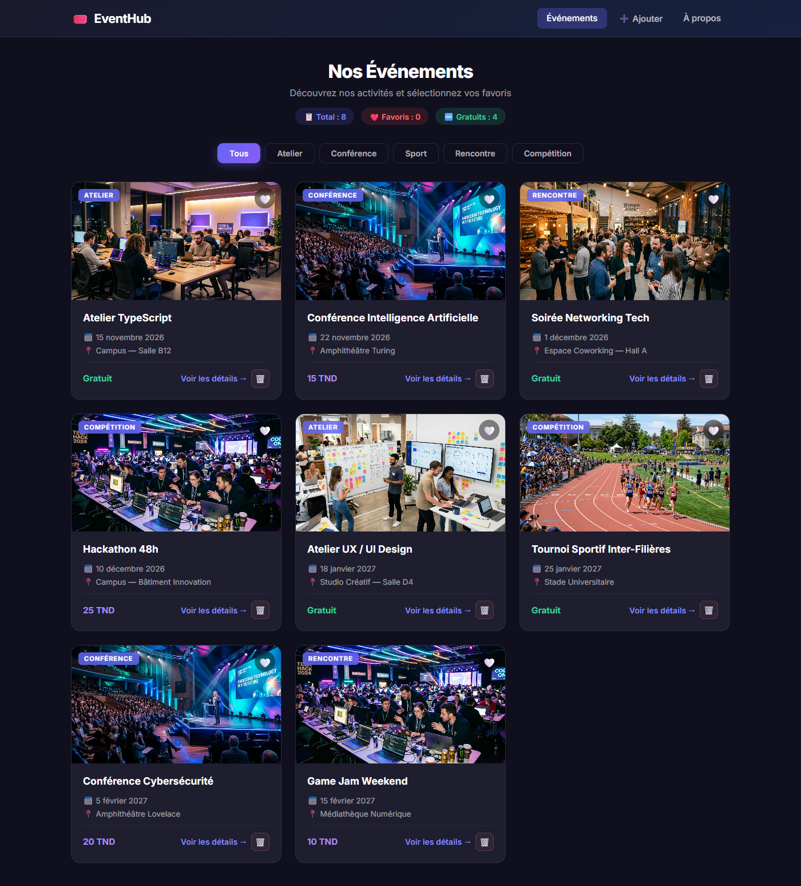
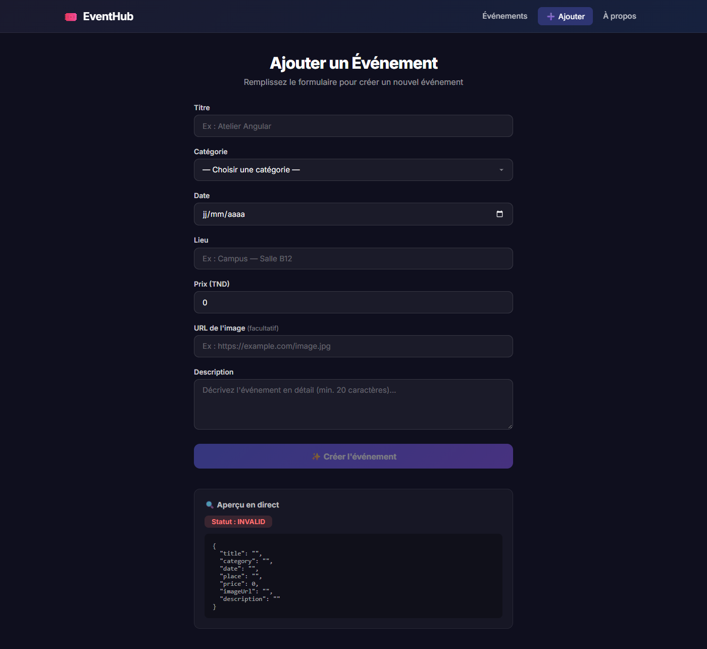

# EventHub — Catalogue d'Événements

Application Angular standalone permettant de consulter les événements d'une association étudiante, d'afficher leurs détails, de filtrer la liste par catégorie, de gérer une sélection de favoris, de créer de nouveaux événements via un formulaire réactif et de supprimer des événements existants.

## Auteur
- **Aziz Jdidi** (aziz.jdidi@esprit.tn)
- Mini-projet Angular

## Versions utilisées

| Technologie | Version |
|---|---|
| Angular | 22.x |
| TypeScript | ~6.0 |
| Node.js | 24.x |
| npm | 11.x |

## Installation et lancement

```bash
# Cloner le dépôt
git clone https://github.com/aziz875/eventhub-azizjdidi.git
cd eventhub-azizjdidi

# Installer les dépendances
npm install

# Lancer le serveur de développement
ng serve
# ou
npm start
```

L'application sera disponible sur `http://localhost:4200/`.

## Structure des composants

| Composant | Rôle |
|---|---|
| **Header** | Affiche le logo de l'application et le menu de navigation (Événements, Ajouter, À propos) avec `routerLink` et `routerLinkActive`. |
| **EventList** | Composant principal qui affiche la liste des événements via le service `EventService`, le filtre par catégorie, les compteurs (total, favoris, gratuits) et permet la suppression. |
| **EventCard** | Carte individuelle d'un événement, reçoit l'événement via `input()`, affiche titre, image, date, prix en Dinars (TND) et catégorie avec des pipes (`date`, `currency`, `uppercase`). Permet d'ajouter/retirer des favoris et de supprimer via `output()`. |
| **EventDetails** | Page de détail d'un événement. Récupère l'identifiant depuis la route via `withComponentInputBinding()` et `input()`. Utilise le service pour retrouver l'événement. Affiche un message d'erreur si l'événement n'existe pas. |
| **EventForm** | Formulaire réactif de création d'événement avec validations (`ReactiveFormsModule`, `FormGroup`, `Validators`). Affiche les valeurs et le statut du formulaire en temps réel via `toSignal()`. |
| **NotFound** | Page 404 affichée pour toute URL inconnue (route `**`). |
| **About** | Page de présentation chargée en **lazy loading** via `loadComponent()`. |

## Service EventService

Service injectable fourni à la racine (`providedIn: 'root'`), source unique des données :

| Méthode | Comportement |
|---|---|
| `getEventById(id)` | Retrouve un événement par identifiant |
| `addEvent(event)` | Ajoute un événement ; génère un ID unique |
| `deleteEvent(id)` | Supprime l'événement et le retire des favoris |
| `toggleFavorite(id)` | Ajoute ou retire l'ID des favoris |

Signaux exposés en lecture seule : `events`, `favorites`, `eventCount`, `favoriteCount`, `freeEventCount`.

## Fonctionnalités réalisées

### Partie 1 — Consultation et navigation
- ✅ Architecture **standalone** (aucun NgModule)
- ✅ **Signals** : `signal()`, `computed()`, `set()`, `update()` pour la gestion d'état réactive
- ✅ **Data binding** : interpolation, property binding `[src]`, event binding `(click)`, `[class.active]`
- ✅ **Control flow** : `@for` avec `track`, `@if`/`@else`, `@empty`
- ✅ **Pipes** : `DatePipe`, `CurrencyPipe` (Dinars Tunisiens TND), `UpperCasePipe`
- ✅ **Communication parent/enfant** : `input()` et `output()`
- ✅ **Routage** : `provideRouter()`, `router-outlet`, `routerLink`, `routerLinkActive`, route paramétrée `/events/:id`
- ✅ **withComponentInputBinding()** pour lier les paramètres de route aux inputs
- ✅ **Lazy loading** de la page À propos avec `loadComponent()`
- ✅ **Filtre par catégorie** (Tous / Atelier / Conférence / Sport / Rencontre / Compétition)
- ✅ **Système de favoris** avec compteur en temps réel
- ✅ **Design responsive** (mobile et desktop)
- ✅ **8 événements** dans 4 catégories, dont 4 gratuits et prix en Dinars

### Partie 2 — Formulaire réactif et service Angular
- ✅ **Formulaire réactif** avec `ReactiveFormsModule`, `FormGroup`, `FormControl`, `Validators`
- ✅ **Validations** : titre (5–50 car.), catégorie obligatoire, date obligatoire, lieu (≥ 3 car.), prix (≥ 0), description (≥ 20 car.)
- ✅ **Messages d'erreur** affichés au toucher du champ invalide
- ✅ **Bouton de soumission désactivé** si formulaire invalide
- ✅ **`toSignal()`** sur `valueChanges` et `statusChanges` pour aperçu JSON et statut en direct
- ✅ **EventService** injectable (`providedIn: 'root'`) avec Signals privés et `asReadonly()`
- ✅ **`computed()`** pour `eventCount`, `favoriteCount`, `freeEventCount` affichés dans la liste
- ✅ **Ajout d'événements** avec génération automatique d'ID unique
- ✅ **Suppression d'événements** avec confirmation et retrait automatique des favoris
- ✅ **État partagé** : tous les composants lisent depuis le service, les changements se propagent instantanément
- ✅ **Route `/events/add`** déclarée avant `/events/:id` pour éviter les conflits

## Captures d'écran

### Liste des événements


### Formulaire de création

